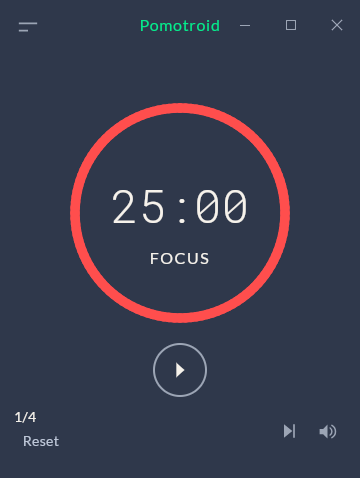

# Pomotroid

Pomotroid is a desktop Pomodoro timer written in Rust. The native interface uses [Rune](https://github.com/anomalyco/rune). The default cycle has four 25-minute focus rounds, five-minute short breaks and a 15-minute long break.



## Run the timer

Install Rust with rustup. On Windows, install the Visual Studio C++ build tools and the Windows SDK. On Linux, install the system development packages listed in the [build workflow](.github/workflows/build.yml).

```sh
cargo run --locked --release
```

Press **Space** to start or pause. **Reset** restarts the current round. **Skip** advances to the next phase and credits the current focus round. Open the menu to change the durations, number of rounds, automatic starts, theme and global shortcuts. Use the speaker control to change the volume.

The release executable embeds the original sounds, fonts and 17 themes. On macOS use the application bundle for desktop notifications. On Linux, notifications use `notify-send` and hiding to the tray requires a desktop panel with a StatusNotifier host.

## Keep your settings

The native app reads the Electron profile's `user-preferences.json`, user themes and daily activity log directory. It saves settings when you change them. Set `POMOTROID_HOME` to a separate directory to try the port with an isolated profile. See the [theme format and profile locations](docs/themes/themes.md).

Local integrations can connect to `ws://127.0.0.1:1314`. Send `{"event":"getState"}` to read the current state. The app broadcasts `roundChange` with the same `data.state` field. States are `idle`, `work`, `short-break`, `long-break` and `paused`. If another instance owns the port, the timer still runs.

## Verify the port

Run the application tests and the independent timer specification.

```sh
cargo test --locked
cargo test --locked --offline --manifest-path verification/Cargo.toml -- --nocapture
```

The checker compares the production timer to a specification across all reachable states within its input bounds. A mismatch prints the shortest sequence of actions that reproduces it. The [verification notes](verification/README.md) explain the bounds and show a counterexample.

Render a timer screen or inspect its accessible controls with Rune's headless driver.

```sh
cargo run --locked -- --snap timer.png
cargo run --locked -- --tree timer.json
```

Run `python scripts/verify-rune.py target/release/pomotroid` to replay the timer controls in the built app. On Windows, pass `target/release/pomotroid.exe`. For a native Windows tray check, run the following on an interactive desktop. It starts a separate profile and waits for a one-minute break to finish with the window hidden.

```powershell
powershell.exe -NoProfile -ExecutionPolicy RemoteSigned -File .\scripts\verify-windows.ps1 -Executable .\target\release\pomotroid.exe
```

The original Vue and Electron sources remain in this checkout for comparison. The native build starts at [src/main.rs](src/main.rs). Cargo builds and runs it independently of Node.js.

## License

MIT. Original Pomotroid design and assets by Christopher Murphy and contributors. See [LICENSE](LICENSE).
